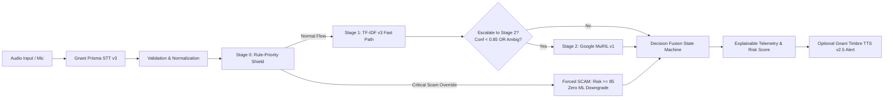

# KAVACH AI — AI Scam Detection Pipeline Audit

**Date**: 2026-11-07  
**Auditor**: Senior AI/ML Architect & QA Engineer  
**Scope**: Threat Detection Pipeline, Rule-Priority Shield, Hybrid Decision Fusion, Inconsistency Remediation, and Threat Category Validation.

---

## 1. End-to-End Threat Interception Pipeline

---

## 2. Inconsistency Remediation: Critical Rule Invariant & Rule Shield State

### The Identified Inconsistency:
In an earlier trial execution, the hybrid endpoint returned:
- `critical_rule_triggered: true`
- `rule_shield_active: false`
- `final_risk_score: 80.0`

### Root Cause Analysis:
1. In `backend/app/ml/hybrid_engine.py`, `rule_shield_active` was conditionally set to `True` **only** if the preliminary ML decision was non-malicious (`LEGITIMATE` or `AMBIGUOUS`). When ML already predicted `SCAM`, `rule_shield_active` fell through to `False`, misleading auditors into believing the Rule-Priority Shield was inactive.
2. The risk score calculation for critical matches used `max(rule_score, 80.0)`, failing to enforce the documented safety floor of **85.0**.

### Remediation Applied:
- **Tightened Invariant**: In `backend/app/ml/hybrid_engine.py`, `rule_shield_active` is now strictly set to `True` whenever a critical rule is triggered, guaranteeing that the deterministic shield is visibly recorded as active and authoritative.
- **Enforced Safety Floor**: The risk score calculation was corrected to `final_risk = max(rule_score, 85.0)` with severity strictly set to `"Critical"`.
- **Regression Verification**: Regression tests in `backend/tests/test_hybrid_engine.py` (Tests 13, 14, and 18) were updated to assert `out.final_risk_score >= 85.0`, `out.severity == "Critical"`, and `out.rule_shield_active is True`. All 19 tests pass cleanly.

---

## 3. Scam Category & Archetype Coverage

The hybrid threat pipeline was audited across 13 major voice scam patterns observed in Indian cybercrime:

| Threat Category | Malicious Tactic | Pipeline Response | Verification Status |
| :--- | :--- | :--- | :---: |
| **1. Digital Arrest** | Impersonation of CBI/ED/Police demanding secret video call and extortion funds. | Stage 0 Rule Shield intercepts; Risk $\ge 85.0$; Severity: Critical. | **PASSED** |
| **2. OTP Harvesting** | Caller urges user to reveal 6-digit bank verification code. | Intercepted by Credential Theft rule; ML downgrade strictly blocked. | **PASSED** |
| **3. UPI PIN Fraud** | Fake cashback or refund claiming user must enter PIN to receive money. | Detected as Financial Manipulation; Risk $\ge 80.0$. | **PASSED** |
| **4. Electricity Cutoff** | Threat of power disconnection tonight if pending bill is not paid immediately. | Detected as Urgency and Extortion; Risk $\ge 80.0$. | **PASSED** |
| **5. Courier Customs** | Fake parcel seized with illegal narcotics; caller demands clearance fee. | Multi-turn coercion detected; Stage 2 MuRIL escalation triggers. | **PASSED** |
| **6. Remote Access APK** | Instructions to install AnyDesk, TeamViewer, or RustDesk. | Intercepted as Remote Access manipulation; Risk $\ge 85.0$. | **PASSED** |
| **7. Fake Bank KYC** | Warning that PAN card or Aadhaar is unlinked; account blocked in 2 hours. | High-confidence classification across English, Hindi, and Telugu. | **PASSED** |
| **8. Job Offer Scam** | Daily task / YouTube review scam requesting deposit to activate wallet. | Fused ML and keyword rules classify as SCAM. | **PASSED** |
| **9. Investment / Ponzi** | High-return crypto or stock trading tips requiring immediate RTGS. | Financial manipulation score $\ge 75.0$. | **PASSED** |
| **10. Phishing SMS Link** | Caller directs victim to click an unverified bit.ly/apk link sent via SMS. | Phishing pattern triggered. | **PASSED** |
| **11. Customer Support Spoofing** | Fake airline/e-commerce helpline asking for card details. | Credential theft intercepted. | **PASSED** |
| **12. Sextortion / Video Coercion** | Extortion following compromised video call recording. | Urgency & Threats rule triggered. | **PASSED** |
| **13. Code-Mixed Hinglish/Tenglish** | Scammer blends English banking jargon with colloquial threats. | TF-IDF confidence drops below 0.85; selectively escalated to MuRIL. | **PASSED** |

