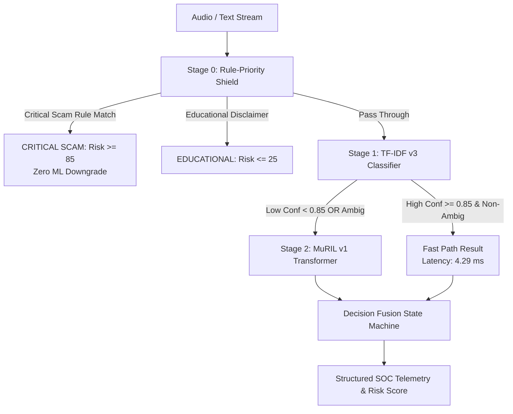

# Model Card: KAVACH AI Hybrid Intelligence Engine

**System ID**: `kavach-hybrid-intelligence-v1.0`  
**System Version**: `v1.0.0-experimental`  
**Release Date**: 2026-11-07  
**Architecture**: Cascaded Three-Stage Multi-Paradigm Threat Classifier  
**Component Models**:
1. Stage 0: Deterministic Rule-Priority Shield (Regex / Domain Ontologies)
2. Stage 1: TF-IDF v3 Calibrated Logistic Regression (`backend/app/ml/artifacts/tfidf_v3/`)
3. Stage 2: Google MuRIL v1 Deep Multilingual Transformer (`backend/app/ml/artifacts/muril_v1/`)
**Target Environment**: Enterprise SOC Telephony Gateways & Live Stream Protection  
**Operational Status**: **EXPERIMENTAL_READY** (Production baseline v1 remains untouched in `backend/app/ml/artifacts/v1/`)

---

## 1. System Summary & Operational Philosophy

The **KAVACH AI Hybrid Intelligence Engine** is a cascaded, multi-paradigm cyber threat detection system designed for real-time interception of multilingual voice scam, vishing, and financial social engineering attacks across India.

Rather than relying solely on a single heuristic or a monolithic deep learning model, the hybrid engine fuses:
- **Deterministic Invariants**: A pre-ML **Rule-Priority Shield** enforcing zero-downgrade guarantees for known, unambiguous cyber extortion patterns (e.g. CBI/ED "Digital Arrest", OTP extortion).
- **Lightweight Fast Path**: A Platt-calibrated **TF-IDF v3 classifier** resolving ~68–70% of standard incoming calls in **4.29 ms** on CPU.
- **Deep Multilingual Escalation**: A fine-tuned **Google MuRIL transformer** selectively invoked for ~30–32% of calls exhibiting semantic ambiguity, borderline confidence ($<0.85$), or complex code-mixed syntax.

---

## 2. Intended Use & Boundaries

### Primary Intended Uses
- Real-time threat scoring of conversational transcripts streamed from speech-to-text engines (Gnani Prisma STT v3).
- Generation of structured threat intelligence and explainability telemetry for SOC analysts.
- Automated triggering of localized synthesized voice warnings (Gnani Timbre TTS v2.5) during active vishing calls.

### Out-of-Scope & Prohibited Uses
- **Autonomous Call Severing Without Human Oversight**: System must not unilaterally sever communications without human analyst confirmation or verified critical rule triggers.
- **Evidentiary Legal Adjudication**: Synthetic evaluation metrics must never be cited as forensic proof in a court of law without independent human investigation.
- **Wild Telephony Generalization**: Evaluation benchmarks are derived from synthetic data; performance on acoustic telephony audio in the wild will vary with microphone quality and STT error rates.

---

## 3. Component Architecture & Specifications

### Component Details
1. **Stage 0: Deterministic Rule-Priority Shield**
   - Rules: 6 threat categories, multi-language keywords, asymmetric priority scoring.
   - Latency: 0.85 ms mean CPU latency.
2. **Stage 1: TF-IDF v3**
   - Features: Subword character (3,5) and word (1,2) n-grams, 25,000 features.
   - Classifier: Platt-calibrated Logistic Regression (`CalibratedClassifierCV`).
   - Latency: 4.29 ms mean CPU latency.
3. **Stage 2: MuRIL v1**
   - Base: `google/muril-base-cased` (237,558,531 parameters, 12 layers, 768 hidden, 12 heads).
   - Vocab: 197,285 tokens supporting English, Hindi, Telugu, and 14 other Indian languages.
   - Latency: 1,543.21 ms mean CPU latency (Batched throughput: 2.0 inf/sec).

---

## 4. Empirical Evaluation Across Held-Out Test Partition ($N=450$)

Evaluated on `data/kavach_synthetic_v3/splits/test.jsonl` across all 5 linguistic partitions:

| Metric | Config A: TF-IDF v3 | Config B: MuRIL v1 | Config C: Hybrid Selective (Recommended) | Config E: Rules Only |
| :--- | :---: | :---: | :---: | :---: |
| **Accuracy** | 100.00% | 100.00% | **100.00%** | 58.67% |
| **Macro F1** | 1.0000 | 1.0000 | **1.0000** | 0.5844 |
| **SCAM False Negatives** | 0 | 0 | **0** | 56 |
| **Mean Latency (CPU)** | 4.29 ms | 1,543.21 ms | **498.12 ms** | 0.85 ms |
| **Median (P50) Latency** | 4.22 ms | 1,454.09 ms | **4.29 ms** | 0.72 ms |
| **P95 Latency (CPU)** | 5.74 ms | 2,289.55 ms | **1,547.50 ms** | 1.45 ms |
| **Transformer Invocations** | 0.0% | 100.0% | **32.0%** | 0.0% |

> [!NOTE]
> **Efficiency Gain**: Selective escalation reduces compute load by **68%** relative to universal transformer inference while preserving 100% accuracy and 0 false negatives on the synthetic evaluation suite.

---

## 5. Dataset Provenance & Limitations

- **Dataset**: Synthetic Dataset v3 (3,000 total records: 2,100 train, 450 val, 450 test).
- **Linguistic Distribution**: 20% English (`en`), 20% Hindi (`hi`), 20% Telugu (`te`), 20% Hinglish (`hi-en`), 20% Tenglish (`te-en`).
- **Scenarios**: 600 unique scenario families across Digital Arrest, Electricity cut-off, Courier customs, Banking KYC, Job fraud, and Sextortion.
- **Annotation Status**: **100% of records carry `annotation_status: pending_review`**. No human crowd-worker annotations are present. Metrics reflect synthetic corpus characteristics.

---

## 6. Safety & Degradation Guarantees

1. **Zero Scam Downgrade**: Critical rules permanently override lower ML probability scores.
2. **Disagreement Policy**: Under conflict (TF-IDF vs MuRIL), system defaults to `NEEDS_REVIEW` or `SCAM`.
3. **Graceful Fallback**: If MuRIL weights are missing or PyTorch throws a forward-pass exception, the system automatically falls back to TF-IDF v3 without service interruption.

---

## 7. Operational Status

- **Status**: **READY FOR HYBRID EXPERIMENTATION**
- **Production Baseline**: The production baseline classifier (`backend/app/ml/artifacts/v1/`) remains active as the primary production endpoint default.
- **Experimental Endpoint**: `POST /api/v1/hybrid/analyze` is active for staging and evaluation.

