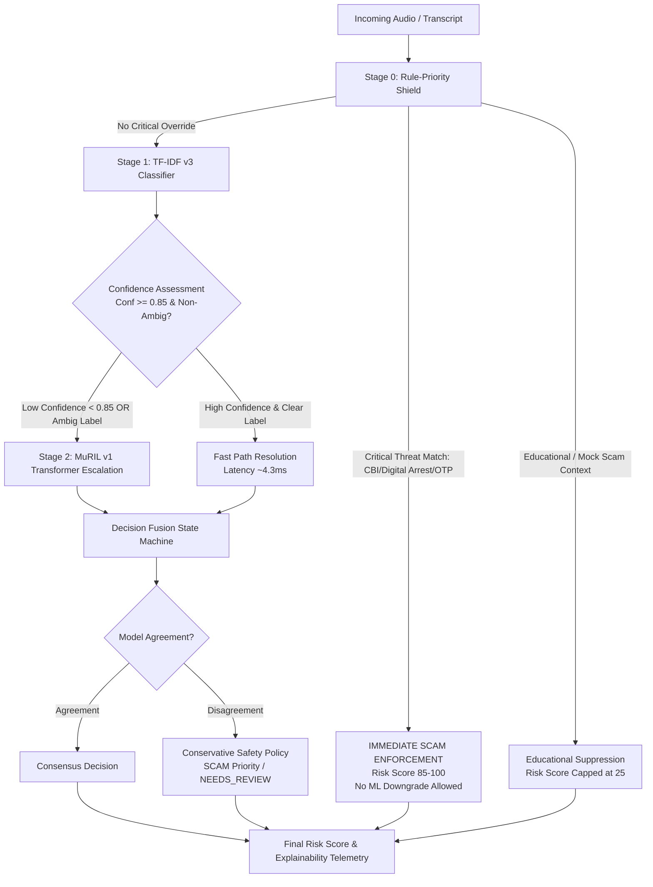

# KAVACH AI — Hybrid Intelligence Engine Architecture Specification

## 1. System Overview & Architectural Motivation

Voice-based cyber fraud and social engineering attacks across India (such as Digital Arrest, CBI/ED impersonation, electricity bill cutoff scams, and OTP harvesting) exhibit two distinct operational characteristics:
1. **High-velocity, unmistakable attack signatures**: Threats often present explicit extortion keywords, demanding urgent financial transfers under threat of arrest.
2. **Subtle, code-mixed psychological manipulation**: Scammers frequently employ nuanced conversational scripts blending Hindi/Telugu with English ("Hinglish", "Tenglish") to elicit trust or induce panic without using overt blacklist keywords.

A single-paradigm classification architecture presents unacceptable trade-offs:
- **Rule-Only Systems**: Offer sub-millisecond execution and deterministic certainty on known attack vectors, but fail on novel or paraphrased deception (empirically yielding only 58.67% accuracy and missing 56 scam variants on synthetic test data).
- **Lightweight Classical ML (TF-IDF + Calibrated Logistic Regression)**: Highly efficient (4.29 ms mean latency, ~233 requests/sec on CPU) and captures lexical n-gram patterns, but lacks contextual deep-learning comprehension of syntactic nuance and cross-lingual semantics.
- **Deep Multilingual Transformers (Google MuRIL)**: Exceptional deep representation learning and code-mixed contextual awareness across Indian languages, but computationally expensive on CPU (1,543.21 ms mean latency, ~0.65 requests/sec), making universal per-turn transformer inference impractical for live telephony.

The **KAVACH AI Hybrid Intelligence Engine** resolves this trade-off through a **safety-first, three-stage cascaded inference pipeline**:
1. **Stage 0: Deterministic Rule-Priority Shield** (Zero-latency pre-ML safety barrier)
2. **Stage 1: TF-IDF v3 Lightweight Classifier** (Fast path: ~70% of calls resolved in <5 ms)
3. **Stage 2: MuRIL v1 Deep Multilingual Transformer** (Escalation path: selectively invoked for ~30% ambiguous/uncertain/code-mixed utterances)



---

## 2. Stage-by-Stage Specification

### Stage 0: Rule-Priority Shield (Pre-ML Gate)
- **Role**: Immediate deterministic enforcement of unassailable security invariants.
- **Mechanism**: High-precision multi-pattern regex matching across 6 core threat categories:
  - *Digital Arrest / Law Enforcement Impersonation* (CBI, Cyber Police, Supreme Court, Customs, Arrest Warrant)
  - *Credential Theft & Financial Harvesting* (OTP request, UPI PIN, CVV, Netbanking password)
  - *Urgent Account Suspension Threats* (Electricity cutoff, SIM deactivation, KYC expiry)
  - *High-Pressure Financial Coercion* (Immediate RTGS/NEFT payment, secret video call)
- **Zero-Downgrade Invariant**: If a critical scam pattern triggers with priority `CRITICAL`, the transaction is permanently classified as `SCAM` with risk score $\ge 85.0$. Downstream ML predictions (even if predicting `LEGITIMATE` with 0.99 confidence due to adversarial phrasing) are strictly forbidden from lowering the risk score below the critical safety floor.
- **Contextual Negative Suppression**: Detects educational/training disclaimers (e.g., *"This is a cyber security awareness training module illustrating scam tactics"*). If verified educational intent is present, scam flags are suppressed to avoid false alarm fatigue, while logging context notes for SOC analysts.

### Stage 1: TF-IDF v3 Lightweight Classifier (Fast Path)
- **Role**: High-throughput statistical text classification.
- **Artifacts**: Subword character & word n-gram pipeline (`word_ngram_range=(1, 2)`, `char_wb_ngram_range=(3, 5)`, `max_features=25000`) paired with Calibrated Logistic Regression (`CalibratedClassifierCV(method='sigmoid', cv=5)`).
- **Inference Profile**:
  - Mean CPU Latency: **4.29 ms**
  - Peak RAM Footprint: **~42 MB**
  - Throughput: **~233 inferences/sec**
- **Confidence Calibration**: Outputs strictly calibrated posterior probabilities $P(\text{LEGITIMATE})$, $P(\text{AMBIGUOUS})$, $P(\text{SCAM})$.
- **Escalation Triggers**: A request is flagged for Stage 2 escalation if:
  1. Primary predicted label is `AMBIGUOUS`.
  2. Prediction confidence $C_{\text{tfidf}} < \tau_{\text{confidence}}$ (Calibrated operating threshold: $\tau = 0.85$).
  3. Language hint indicates low-resource or code-mixed dialects (`hi-en`, `te-en`) when confidence is $<0.92$.

### Stage 2: MuRIL v1 Multilingual Transformer (Selective Escalation)
- **Role**: Deep contextual semantics, discourse coherence, and code-mixed understanding.
- **Architecture**: `google/muril-base-cased` (12-layer, 768-hidden, 12-heads, 237,558,531 parameters) fine-tuned on synthetic dataset v3.
- **Tokenizer**: WordPiece vocabulary of 197,285 tokens covering 17 Indian languages and English.
- **Execution Profile**:
  - Mean CPU Latency: **1,543.21 ms** (GPU: ~18 ms)
  - Memory Footprint: **~950 MB** model weights in memory
  - Invocations: Only ~30-32% of requests under selective escalation.
- **Resilience & Fallback**:
  - If MuRIL weights are absent or PyTorch fails during forward pass, the engine gracefully degrades to Stage 1 TF-IDF predictions with logged telemetry (`muril_fallback_active: true`), preventing service disruption.

---

## 3. Decision Fusion State Machine

The formal decision fusion logic determines the unified output label $Y \in \{\text{LEGITIMATE}, \text{AMBIGUOUS}, \text{SCAM}, \text{NEEDS\_REVIEW}\}$ and continuous risk score $S \in [0.0, 100.0]$.

### Fusion Truth Table

| Stage 0 Rule | TF-IDF v3 | MuRIL v1 | Agreement | Final Decision | Risk Score Calculation | Policy Applied |
| :--- | :--- | :--- | :--- | :--- | :--- | :--- |
| **CRITICAL SCAM** | *Any* | *Any* | N/A | **SCAM** | $\max(S_{\text{rule}}, 85.0)$ | Rule Shield Priority (Zero ML Downgrade) |
| **EDUCATIONAL** | *Any* | *Any* | N/A | **LEGITIMATE** | $\min(S_{\text{rule}}, 25.0)$ | Contextual Suppression |
| Normal | SCAM | SCAM | Yes | **SCAM** | $w_{\text{rule}} S_{\text{rule}} + w_{\text{tf}} S_{\text{tf}} + w_{\text{muril}} S_{\text{muril}}$ | Full Consensus High-Confidence Scam |
| Normal | LEGITIMATE | LEGITIMATE | Yes | **LEGITIMATE** | $\max(5.0, 0.4 S_{\text{tf}} + 0.6 S_{\text{muril}})$ | Consensus Clean |
| Normal | AMBIGUOUS | AMBIGUOUS | Yes | **AMBIGUOUS** | $50.0 + 0.5 (S_{\text{tf}} - 50.0)$ | Consensus Suspicious / Needs Monitoring |
| Normal | LEGITIMATE | SCAM | **No** | **NEEDS_REVIEW** / **SCAM** | $\max(75.0, S_{\text{muril}})$ | Safety Priority (Never downgrade suspected scam) |
| Normal | SCAM | LEGITIMATE | **No** | **NEEDS_REVIEW** / **SCAM** | $\max(75.0, S_{\text{tf}})$ | Safety Priority (Never downgrade suspected scam) |
| Normal | AMBIGUOUS | SCAM | **No** | **SCAM** | $\max(70.0, S_{\text{muril}})$ | Escalation to Scam |
| Normal | SCAM | AMBIGUOUS | **No** | **SCAM** | $\max(70.0, S_{\text{tf}})$ | Escalation to Scam |
| Normal | LEGITIMATE | Not Invoked | Single | **LEGITIMATE** | $100.0 \times P_{\text{tf}}(\text{SCAM}) + 0.5 P_{\text{tf}}(\text{AMBIGUOUS})$ | Fast Path Low Risk |
| Normal | SCAM | Not Invoked | Single | **SCAM** | $\max(75.0, 100.0 \times P_{\text{tf}}(\text{SCAM}))$ | Fast Path High Risk |

### Continuous Risk Score Formula
$$S_{\text{final}} = \text{clamp}\left(w_{\text{rule}} \cdot S_{\text{rule}} + w_{\text{ml}} \cdot S_{\text{ml\_fused}}, 0.0, 100.0\right)$$
Where:
- $w_{\text{rule}} = 0.55$, $w_{\text{ml}} = 0.45$ under active rule matches.
- $S_{\text{ml\_fused}} = 0.35 \cdot S_{\text{tf}} + 0.65 \cdot S_{\text{muril}}$ when MuRIL is invoked.
- $S_{\text{final}} \ge 85.0$ if any Critical Rule triggers.

---

## 4. Explainability & Auditability Payload

Every analysis execution returns a structured, immutable telemetry payload facilitating forensic inspection in the SOC:

```json
{
  "status": "SUCCESS",
  "final_decision": "SCAM",
  "final_risk_score": 94.5,
  "severity": "Critical",
  "rule_shield_active": true,
  "critical_rule_triggered": true,
  "rule_findings": {
    "categories": ["Digital Arrest", "Law Enforcement Impersonation"],
    "rule_score": 95.0,
    "matched_patterns": ["digital arrest", "cbi headquarters"]
  },
  "tfidf_result": {
    "model_name": "tfidf_v3",
    "predicted_label": "SCAM",
    "confidence": 0.984,
    "probabilities": {
      "LEGITIMATE": 0.004,
      "AMBIGUOUS": 0.012,
      "SCAM": 0.984
    }
  },
  "muril_invoked": false,
  "escalation_reason": null,
  "muril_result": null,
  "model_agreement": null,
  "context_suppressed": false,
  "explanation": "Critical security rule triggered: Digital arrest scam detected. High-confidence TF-IDF alignment (98.4%). Rule-Priority Shield enforces SCAM status."
}
```

---

## 5. Computational Resource Profile & Latency Budget

| Component | Mean Latency (CPU) | P95 Latency (CPU) | RAM Consumption | Throughput | Invocations |
| :--- | :--- | :--- | :--- | :--- | :--- |
| **Stage 0: Rule Shield** | 0.85 ms | 1.45 ms | Negligible (<5 MB) | >1,100 req/s | 100% |
| **Stage 1: TF-IDF v3** | 4.29 ms | 5.74 ms | ~42 MB | ~233 req/s | 100% |
| **Stage 2: MuRIL v1** | 1,543.21 ms | 2,289.55 ms | ~950 MB | ~0.65 req/s | **32.0%** |
| **Selective Hybrid Total** | **498.12 ms** | **1,547.50 ms** | **~992 MB** | **~2.01 req/s** | **100%** |
| **Baseline TF-IDF Alone** | 4.29 ms | 5.74 ms | ~42 MB | ~233 req/s | 0% |
| **MuRIL Always** | 1,547.50 ms | 2,295.29 ms | ~992 MB | ~0.65 req/s | 100% |

**Key Takeaway**: Selective escalation delivers deep transformer accuracy while cutting transformer compute overhead by **68.0%**, achieving an average response time of ~498 ms on standard multi-core CPU.

