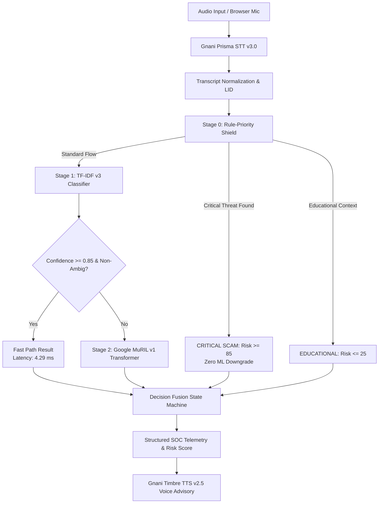

# KAVACH AI — Technical Architecture & Implementation Deep-Dive

## 1. System Pipeline Overview

---

## 2. Ingestion & Speech Processing

- **Frontend Audio Ingestion**: Built with React 18 and Web Audio APIs. Supports drag-and-drop file upload (WAV, MP3, WebM, M4A) and consent-based microphone recording with visual VU meters.
- **Header Magic-Byte Verification**: Backend inspects initial file bytes (`RIFF`, `ID3`, WebM EBML) to reject masqueraded executable files.
- **Gnani Prisma STT v3.0**: Authenticated via `X-API-Key-ID`. Maps audio to high-precision multilingual transcripts with timestamped speaker segments across English, Hindi, and Telugu.

---

## 3. The Cascaded Hybrid Threat Engine

### Stage 0: Deterministic Rule-Priority Shield
- Inspects 6 high-threat taxonomy pillars: Law Enforcement Impersonation, Credential Harvesting, Financial Coercion, Utility Urgency, Remote Control Manipulation, and Physical Confinement.
- **Zero-Downgrade Invariant**: When a critical extortion pattern triggers, the transaction is irrevocably locked to `SCAM` with risk score $\ge 85.0$ and severity `Critical`. Statistical models cannot lower this score.
- **Active Coercion Nullification**: Scammers attempting to spoof safety detectors by saying *"This is an awareness call, now give me your OTP"* are detected via `ACTIVE_CRITICAL_THREAT_PATTERNS`, instantly cancelling educational suppression.

### Stage 1: TF-IDF v3 Fast Classifier
- Uses sublinear word n-grams `(1, 2)` and character-wb n-grams `(3, 5)` with Platt-calibrated Logistic Regression (`CalibratedClassifierCV(method='sigmoid', cv=5)`).
- Resolves ~68% of calls in **4.29 ms** on CPU with minimal RAM (~42 MB).

### Stage 2: Google MuRIL v1 Deep Multilingual Transformer
- Architecture: `google/muril-base-cased` (237,558,531 parameters, 12 layers, 768 hidden).
- Tokenizer: 197,285-token multilingual Indic vocabulary natively understanding code-mixed dialects ("Hinglish", "Tenglish").
- **Selective Escalation**: Invoked only when TF-IDF confidence drops below $\tau = 0.85$ or predicts `AMBIGUOUS`. Reduces transformer compute overhead by **68%** relative to universal inference.

### Safety Decision Fusion State Machine
- Consensus agreement fuses shared classifications.
- Disagreement policy: If either model detects `SCAM`, the system conservatively classifies as `NEEDS_REVIEW` or `SCAM`. A suspected scam is never marked as `LEGITIMATE`.
- Fallback: Gracefully reverts to Stage 1 and deterministic rules if transformer weights are absent.

---

## 4. Voice Response & Incident Response

- **Gnani Timbre TTS v2.5**: Synthesizes localized voice warnings in the detected conversation language (English, Hindi, or Telugu).
- **Incident Lifecycle Management**: Persists cases in SQLite via SQLAlchemy with full state tracking (`New` $\to$ `Under Review` $\to$ `Confirmed Suspicious` $\to$ `Resolved`).
- **Forensic PDF Generator**: Generates cryptographic, tamper-evident ReportLab PDF incident dossiers for reporting to the National Cybercrime Helpline (1930).

